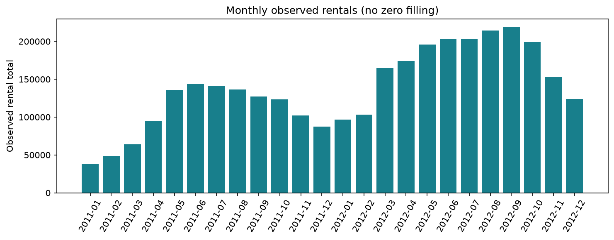
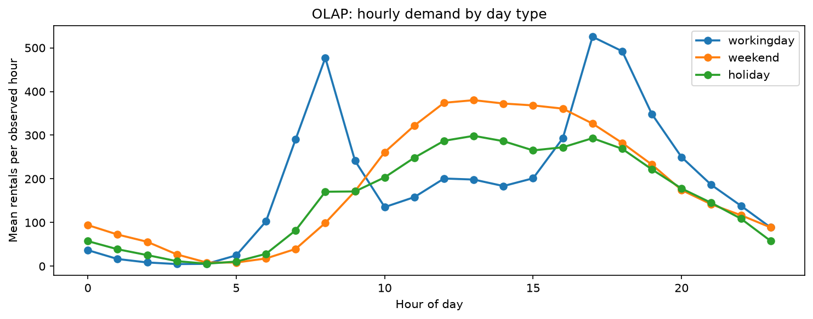
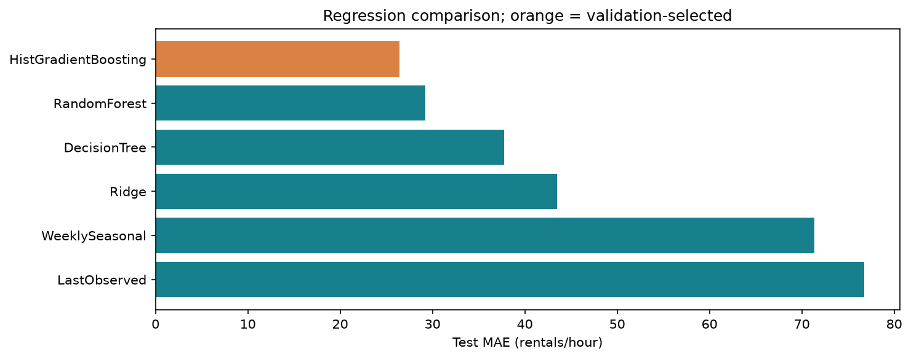
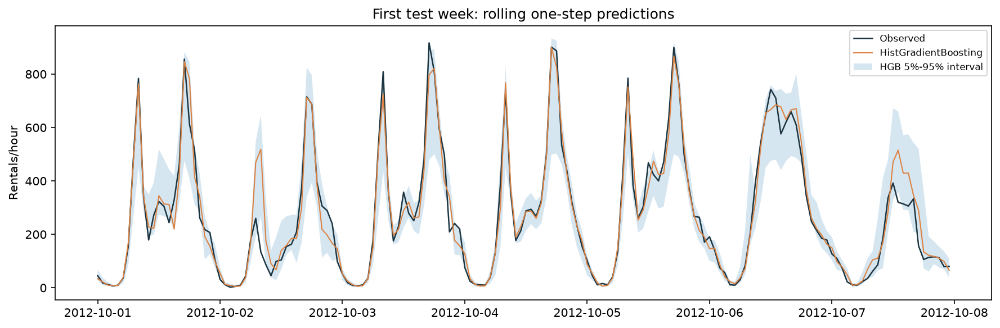
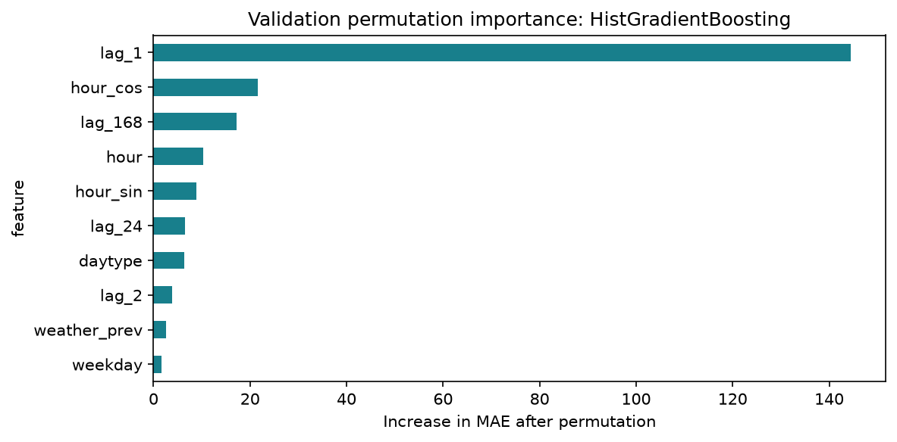
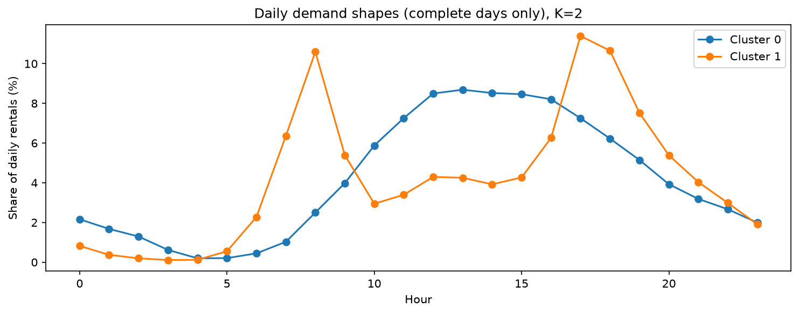

# 共享单车需求的数据仓库、多维分析与数据挖掘

> 完整课程实验｜可复现 Python + Jupyter 项目｜固定随机种子 42

## 摘要

本项目以共享单车小时需求为主线，完成公开数据收集、质量审计、星型数据仓库、OLAP、回归、分类、聚类及关联规则挖掘，并将预测结果回写仓库。实际输入为 **17,379 条小时观测、731 天**，覆盖 2011—2012 年。仓库保存租赁总量 **3,292,679 次**。

预测任务为滚动单步：在小时 t 开始前，用截至 t−1 的需求/天气和已知日历信息预测 t 的需求。按验证集 MAE 选择的 **HistGradientBoosting** 在独立测试期的 MAE 为 **26.44**、RMSE 为 **42.64**，相对“上周同小时优先”的基线 MAE 改善 **62.9%**。这些是本次运行值，不是从示例文档复制的成绩。

## 1. 研究问题与任务对应

1. 不同日期、时段和天气条件下，观测需求如何变化？用数据仓库和 OLAP 描述。
2. 下一小时需要多少车？用回归模型预测。
3. 下一小时是否属于高需求？用分类模型识别。
4. 完整日期有哪些典型用车形状？用聚类发现。
5. 哪些属性组合与高需求共现？用 Apriori 找关联，并在后续时期复核。

| 课程要求 | 本项目实现 | 可检查产物 |
| --- | --- | --- |
| 数据收集 | 官方原始压缩包、SHA256 校验、来源清单 | data/raw/ |
| 预处理 | 类型、重复、缺失、范围、时间轴、日/小时汇总一致性检查 | data/processed/；results/data_quality.json |
| 数据仓库 | 原始层→清洗层→星型仓库→结果层 | warehouse.sqlite；sql/schema.sql |
| OLAP | 上卷、下钻、切片、切块、旋转、二维 CUBE | sql/01 至 06；对应结果 CSV |
| 数据挖掘 | 回归、分类、聚类、关联规则 | project.py；results/ |
| 结果评价 | 时间验证、误差、分类指标、轮廓系数、支持度/置信度/提升度 | 本报告及完整 Notebook |
| 分析闭环 | 测试预测回仓，按模型/月/日类型分析误差 | sql/07_model_olap.sql |

## 2. 数据收集与来源

数据采用 UCI Bike Sharing 原始压缩包的 `hour.csv` 与 `day.csv`，保留随包的 `Readme.txt`。来源、文件 SHA256 和核验时间保存在 `data/raw/manifest.json`。已有原始包时可完全离线重跑；删除原始包后脚本会从同一地址重新下载并核对固定 SHA256。

数据描述的是华盛顿特区 Capital Bikeshare 的历史汇总需求，不含站点级位置、库存或个人轨迹，因此项目结论限于总体需求，不能直接生成站点调度路线。UCI 页面采用 CC BY 4.0；保留数据集与原论文引用。

**元数据处理：**下载文件的行数与 UCI 页面展示数存在差异，且网页和包内说明的 season 命名、温度反归一化说明不一致。本项目按真实文件计数，季节仅记为 `season_1` 至 `season_4`，温度保留原始归一化值，不声称某编码一定是某个自然季节，也不据不一致说明换算摄氏温度。

## 3. 预处理与质量审计

| 检查项 | 本次结果 |
| --- | --- |
| 原始记录 / 清洗后记录 | 17379 / 17379 |
| 删除的完全重复行 | 0 |
| 原始单元格缺失数 | 0 |
| 日历应有小时数 | 17544 |
| 没有观测行的小时数 | 165 |
| 24 小时均完整的日期数 | 655 |
| 小时租赁加总与 day.csv 一致 | True |

“字段没有空值”不代表“时间轴没有缺口”。生成完整小时索引只是为了精确构建 t−24、t−168 等时间特征，**不把缺失小时当成零租赁，不生成虚构标签**。仓库只装载原始真实观测。聚类只用完整的 24 小时日期；OLAP 均值分母是已观测小时，并另存每月覆盖率。

检查主键与时间戳唯一性、非负计数、类别范围、日期字段一致性，以及 `cnt = casual + registered`。完全重复行可移除；冲突主键和非法数据会中止流程。真实极值可能是通勤高峰，未用简单截尾方式删除。特征缺失由各训练窗口拟合的中位数填补，并保留缺失指示器。

## 4. 数据仓库

这是适用于课程规模的 **SQLite 关系型 OLAP 仓库**。事实表粒度为“整个系统某个日期某个小时的一次真实需求观测”。事实与维度通过外键约束，事务装载，完成一致性检查后替换旧库；重跑全量 ETL 不会重复累加。它不是生产级增量/SCD 系统。

```text
dim_date ───────┐                     dim_model
dim_hour ───────┤                         │
dim_weather ────┼── fact_rentals ── fact_predictions
dim_season ─────┤
dim_daytype ────┘
```

- `dim_date`：日期→月→季度→年的层级，并保存星期。
- `dim_hour`：小时→时段；`dim_weather`：天气代码；`dim_season`：原始季节编码。
- `dim_daytype`：工作日、周末、节假日；节假日优先，不重复归类。
- `fact_rentals`：总量、临时用户量、注册用户量以及归一化气象观测。
- `fact_predictions`：模型×测试观测的预测值、真实值、绝对误差。
- `etl_log`：数据校验值、装载行数、租赁总量和完成时间。

租赁计数可跨时间相加；均值需由总量与观测数重新计算，不能把不同分组均值直接平均。模型误差分析不把不同模型预测相加成业务总量。`PRAGMA foreign_key_check`、`integrity_check` 和总量守恒均由程序验证。

## 5. OLAP 操作与结果

| 操作 | 本项目实例 |
| --- | --- |
| 上卷 Roll-up | 月度总量→年度总量→全部年份总量 |
| 下钻 Drill-down | 2012 年 9 月→日期→小时 |
| 切片 Slice | 固定 2012 年，比较各日类型的小时均值 |
| 切块 Dice | 2012 年 7—9 月、工作日、天气 1/2、早晚通勤时段 |
| 旋转 Pivot | 小时为行，工作日/周末/节假日为列 |
| 多维 CUBE | season×日类型，含各维小计与总计 |

SQLite 没有原生 `ROLLUP/CUBE` 语法，SQL 用明确的 `GROUP BY + UNION ALL` 实现对应分组集合，并提供汇总标志。既有 SQL 源码，也有真实结果表，不能将普通画图等同于完成 OLAP。





本次全期旋转表显示，工作日平均需求最高的小时为 **17:00**，周末为 **13:00**。这是历史关联而非因果效果，年份增长、天气构成与缺行覆盖率可能影响组间比较。月份总量同时受月份长度影响，应结合每小时均值与覆盖率。

## 6. 预测设计与防止信息泄漏

| split | rows | start | end |
| --- | --- | --- | --- |
| train | 12842 | 2011-01-08 | 2012-06-30 23:00:00 |
| validation | 2208 | 2012-07-01 | 2012-09-30 23:00:00 |
| test | 2168 | 2012-10-01 | 2012-12-31 23:00:00 |

先保留 168 个小时作特征预热，仅真实目标存在的时刻参与监督评价。2012-07-01 前为训练集；7—9 月验证并选模型；10—12 月为测试集。训练集内部另做 3 折扩展窗口交叉验证，明细保存在 `regression_temporal_cv.csv`。所有拟合型变换在相应训练段内拟合。

**输入：**目标小时的已知日历特征、距起点天数、小时周期编码、真实时间间隔的 1/2/24/168 小时需求滞后、仅使用过去值的滚动统计，以及前一小时天气观测。**禁止输入：**目标小时天气实测值、目标小时 `casual/registered`、目标值、记录编号。因为后两类用户数相加等于标签，把它们输入模型会导致直接泄漏。

每次预测后可以观察真实需求，再更新下一小时的滞后输入；测试期模型参数保持不变。因此这是**滚动单步预测**，不是在 10 月 1 日一次性预测整个季度。缺失的上一小时无法凭空获知，由训练期中位数和缺失标志处理。基线 `LastObserved` 用最近已观测值；`WeeklySeasonal` 优先上周同小时，缺失时退回昨日同小时、再退回最近已观测值。

## 7. 回归预测

比较 Ridge 线性模型、决策树、随机森林和直方图梯度提升树，加上两种朴素基线。树深、迭代次数等参数在代码中固定。所有输出按计数语义截断为非负，未四舍五入；使用 MAE、RMSE、R² 和 WAPE。WAPE 的分母为整体实际总量，避免把逐小时低需求 MAPE 误当作稳定指标。

| 算法 | 核心思想 | 本实验中的作用 |
| --- | --- | --- |
| Ridge | 最小化平方误差并以 L2 惩罚限制系数 | 可解释的线性对照 |
| 决策树 | 按特征阈值递归划分，使叶内目标更一致 | 捕获非线性与阈值效应 |
| 随机森林 | 对随机化训练样本和特征训练多棵树并集成 | 降低单树方差 |
| 梯度提升 | 逐轮用新树修正当前模型损失的下降方向 | 拟合复杂的滞后与日历关系 |
| 逻辑回归 | 对线性评分做 sigmoid 转换得到类别概率 | 高需求分类的线性对照 |
| K-Means | 交替分配样本与更新中心，降低簇内平方距离 | 发现每日需求形状 |
| Ward 层次聚类 | 每步合并使簇内平方和增量最小的两簇 | 聚类方法对照 |
| Apriori | 利用频繁项集的子集也必须频繁来剪枝 | 发现可解释的共现规则 |

MAE = 平均绝对误差；RMSE = 均方误差平方根，对大误差更敏感；WAPE = 绝对误差总和 / 实际需求总和。不同指标衡量不同方面，不应只报告最佳的一个。

### 验证集：用于选模型

| model | MAE | RMSE | R2 | WAPE_percent |
| --- | --- | --- | --- | --- |
| HistGradientBoosting | 32.738 | 49.753 | 0.954 | 11.354 |
| RandomForest | 34.746 | 55.025 | 0.943 | 12.050 |
| DecisionTree | 42.516 | 66.701 | 0.917 | 14.744 |
| Ridge | 47.131 | 68.474 | 0.912 | 16.345 |
| WeeklySeasonal | 55.998 | 97.892 | 0.820 | 19.420 |
| LastObserved | 95.181 | 139.615 | 0.635 | 33.008 |

### 测试集：仅用于最终评价

| model | selected_on_validation | MAE | RMSE | R2 | WAPE_percent |
| --- | --- | --- | --- | --- | --- |
| HistGradientBoosting | True | 26.438 | 42.639 | 0.955 | 12.061 |
| RandomForest | False | 29.213 | 47.934 | 0.943 | 13.327 |
| DecisionTree | False | 37.755 | 62.906 | 0.903 | 17.224 |
| Ridge | False | 43.513 | 65.032 | 0.896 | 19.851 |
| WeeklySeasonal | False | 71.340 | 118.895 | 0.652 | 32.546 |
| LastObserved | False | 76.772 | 119.821 | 0.647 | 35.024 |

展示所有预先定义模型的测试结果只是对照，不依据测试排序更换已选模型。验证集选择 **HistGradientBoosting**，最终用训练+验证期重新拟合。





另用梯度提升分位数回归构建名义 90% 区间。原始分位数交叉比例为 0.00%，评价前对上下界排序；实测覆盖率 **81.87%**，平均宽度 **120.00**。该区间没有额外保序/共形校准，名义 90% 不保证达到 90%。点预测和区间可能来自不同模型。



置换重要性只用验证集、且模型只在训练集拟合；用于解释而非重新筛选特征。高度相关的滞后变量会分摊重要性，该值也不代表因果作用。

## 8. 高需求分类

“高需求”定义为小时租赁量 ≥ 训练集第 75 百分位，即 **248 次/小时**。阈值在训练期确定后固定，不因测试集分布而改变。逻辑回归、决策树、随机森林共用无泄漏特征，按验证集 F1 选模型，概率阈值固定 0.5。追加训练期先验概率基线。

| model | selected_on_validation | Accuracy | BalancedAccuracy | Precision | Recall | F1 | ROC_AUC | AveragePrecision |
| --- | --- | --- | --- | --- | --- | --- | --- | --- |
| LogisticRegression | False | 0.936 | 0.928 | 0.920 | 0.900 | 0.910 | 0.979 | 0.968 |
| DecisionTree | False | 0.926 | 0.923 | 0.882 | 0.915 | 0.899 | 0.974 | 0.946 |
| RandomForest | True | 0.942 | 0.940 | 0.910 | 0.932 | 0.921 | 0.987 | 0.977 |
| PriorBaseline | False | 0.641 | 0.500 | 0.000 | 0.000 | 0.000 | 0.500 | 0.359 |

验证集选定 **RandomForest**，测试 F1 为 **0.921**，召回率 **0.932**。Average Precision 为 sklearn 的 AP 定义，不声称是梯形积分 PR-AUC。

混淆矩阵：

| pred_normal | pred_high | actual |
| --- | --- | --- |
| 1317 | 72 | normal |
| 53 | 726 | high |

高需求标签是课程实验定义，不等同于真实“供不应求”；缺少库存、可用车和未满足订单数据，不能把高需求直接解释为缺车。

## 9. 每日需求模式聚类

每个完整日期表示为 24 维租赁向量，并除以当天总量转为小时份额，使聚类更关注形状而非规模。仅使用 **655 个完整日期**，其余日期排除并公开数量，不将缺行填零。K-Means 在 K=2…6 中按轮廓系数选择 K，同 K 的 Ward 层次聚类作为对照。

| method | k | silhouette |
| --- | --- | --- |
| KMeans | 2 | 0.621 |
| KMeans | 3 | 0.365 |
| KMeans | 4 | 0.345 |
| KMeans | 5 | 0.204 |
| KMeans | 6 | 0.200 |
| AgglomerativeWard | 2 | 0.615 |

| kmeans_cluster | days | mean_daily_rentals | workday_fraction |
| --- | --- | --- | --- |
| 0 | 216 | 4507.676 | 0.032 |
| 1 | 439 | 4927.902 | 0.993 |



`workday_fraction` 表示簇内工作日占比，`mean_daily_rentals` 为原始日总量均值。先观察簇中心的早晚峰和工作日占比，再解释通勤或休闲特征，不人为给簇贴好坏标签。聚类使用全期数据进行**回顾性探索**，不参与监督模型训练，不能把轮廓系数称为预测准确率。

## 10. Apriori 关联规则

一条事务是一条真实小时观测，项目包括季节编码、日类型、时段、当时天气、需求高低。采用逐层候选连接和子集剪枝的 Apriori，最小支持度 0.03、最小置信度 0.50、最大项集长度 3；仅保留后件为 `demand=high` 且提升度大于 1 的规则。

支持度为 P(A∩B)，置信度为 P(B|A)，提升度为 P(B|A)/P(B)。规则只在训练期挖掘，按训练提升度排序，再用固定定义在测试期复核。天气为当时观测，因此规则是**描述性共现**，不能直接当提前预测方法或因果关系。

本次发现 **5 条**满足阈值的规则，以下最多显示前 10 条：

| antecedent | consequent | train_support | train_confidence | train_lift | test_antecedent_count | test_support | test_confidence | test_lift |
| --- | --- | --- | --- | --- | --- | --- | --- | --- |
| period=evening_peak & season=2 | demand=high | 0.047 | 0.837 | 3.371 | 0 | 0.000 | — | — |
| period=evening_peak & weather=1 | demand=high | 0.085 | 0.715 | 2.882 | 221 | 0.084 | 0.828 | 2.305 |
| daytype=1 & period=evening_peak | demand=high | 0.081 | 0.704 | 2.834 | 244 | 0.099 | 0.877 | 2.441 |
| period=evening_peak | demand=high | 0.109 | 0.649 | 2.614 | 364 | 0.131 | 0.777 | 2.164 |
| daytype=2 & period=daytime | demand=high | 0.047 | 0.644 | 2.596 | 156 | 0.054 | 0.744 | 2.069 |

训练与测试基础高需求比例可能不同，需结合测试前件样本数、测试置信度和提升度，不只看高置信度。小时样本存在时间相关性，本项目未给出独立样本假设下的显著性结论，也未进行多重假设校正。

若测试前件样本数为 0，置信度与提升度显示“—”，表示该规则在本测试窗口**无法验证**，而不是验证失败或得到零提升度。尤其季节组合可能根本不出现在最后一个季度，需在覆盖相应季节的新数据中继续检验。

## 11. 结果回仓与应用解释

所有回归模型的测试预测以“模型×观测小时”为粒度入仓。`07_model_olap.csv` 可按月份、日类型查看 MAE，连接需求分析和模型诊断。可以据此提出候选运营策略：分别研究工作日通勤峰与周末高峰、监测误差较大时段、结合概率区间预留弹性资源。但实际调度还需要站点库存、成本约束及更近期数据验证。

## 12. 局限与后续工作

- 两年单城市历史汇总数据只能用于课程实验，不代表当前城市需求；没有站点级空间维度。
- 缺失小时的原因无法仅从数据确定，未假设全部为零；聚类对完整日期的筛选可能产生选择偏差。
- 固定时间划分体现后向外推，但并非所有季节/年份的重复独立验证；不能宣称模型普遍最优。
- 已知日历可在预测前获得，而未来天气未知；本项目只用上一小时天气。多步预测需重新设计特征与评价。
- 高需求阈值、关联规则阈值和模型参数都是实验设计选择；真实业务还应进行成本敏感分析、漂移监控和误差校准。
- 仓库为单机课程原型，采用可重复全量装载；生产部署可增加增量 ETL、历史维度和访问管理。

## 13. 复现与验收

在项目目录安装 `requirements.txt` 后执行：

```bash
python project.py
python -m unittest discover -s tests -v
```

也可打开 `bike_sharing_full_project.ipynb` 顺序运行。Notebook 与命令行调用相同的分阶段函数，SQL 文件可以单独修改后运行。原始数据已打包，重跑不要求联网下载；环境安装可能需要联网。本次运行 Python 3.14.9，流水线用时约 15.7 秒，详见 `results/environment.json`。时间与线程调度随机器变化。

自动测试覆盖时间缺口的真实滞后语义、修改未来数据不改变过去特征、Apriori 小例子的支持度，以及仓库总量、外键、聚合守恒和预测回仓规模。报告不将“文件存在”当成算法通过；最终验收还检查 Notebook 是否全部执行无错误。

## 参考资料

1. Fanaee-T, H. (2013). Bike Sharing [Dataset]. UCI Machine Learning Repository. [DOI: 10.24432/C5W894](https://doi.org/10.24432/C5W894)。[数据集页面](https://archive.ics.uci.edu/dataset/275/bike+sharing+dataset)。
2. Fanaee-T, H., & Gama, J. Event labeling combining ensemble detectors and background knowledge. [DOI: 10.1007/s13748-013-0040-3](https://doi.org/10.1007/s13748-013-0040-3)。
3. scikit-learn developers. [Lagged features for time series forecasting](https://scikit-learn.org/stable/auto_examples/applications/plot_time_series_lagged_features.html)。原有 Notebook 的方法参考，本项目重新实现时间对齐、仓库与完整分析。
